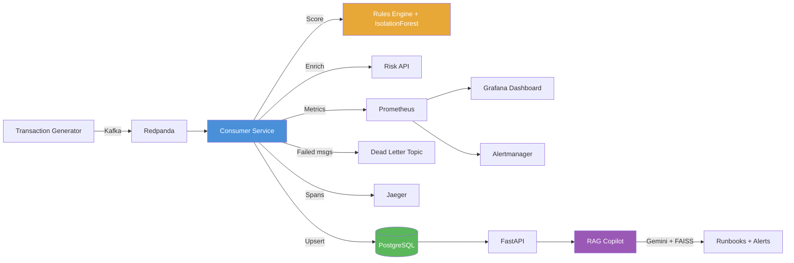

# 🛡️ Fraud Signal Pipeline

Real-time fraud detection pipeline that scores payment transactions using **rules + IsolationForest ML model**, with full **resiliency patterns** (retries, timeouts, circuit breaker, graceful degradation), **distributed tracing**, **structured logging**, and a **RAG-based incident copilot**.

> Built to demonstrate production-grade backend engineering: streaming, reliability-first design, observability, and AI-assisted operations.

---

## Architecture



## Stack

| Component | Technology | Purpose |
|-----------|-----------|---------|
| **Stream** | Redpanda (Kafka-compatible) | Message broker for real-time transaction events |
| **Service** | Python 3.12, FastAPI, aiokafka | Async consumer + REST API |
| **Scoring** | Rules engine + scikit-learn IsolationForest | Two-layer fraud detection with explainable reasons |
| **Storage** | PostgreSQL 16, SQLAlchemy async | Idempotent upserts via `ON CONFLICT` on `transaction_id` |
| **Resiliency** | tenacity, custom async circuit breaker, asyncio | Retries (exp backoff), 300ms timeouts, circuit breaker, graceful degradation |
| **Observability** | structlog, prometheus-client, OpenTelemetry, Jaeger, Grafana | JSON logs with trace IDs, metrics, distributed tracing, dashboards |
| **GenAI** | LangChain, FAISS, Gemini API | RAG copilot: runbooks + alerts → incident summaries + next actions |
| **Testing** | pytest, testcontainers, Locust | Unit, integration, resiliency, and performance tests |
| **CI/CD** | GitHub Actions | Lint (ruff), test, docker build |

## Quick Start

**Run the entire pipeline in 2 commands:**

```bash
# 1. Start everything
docker compose up -d --build

# 2. Watch the demo
make demo
```

**Access the services:**

| Service | URL |
|---------|-----|
| API (Swagger docs) | http://localhost:8000/docs |
| Grafana Dashboard | http://localhost:3000 |
| Jaeger Tracing | http://localhost:16686 |
| Prometheus | http://localhost:9090 |
| Alertmanager | http://localhost:9093 |

## Key Features Demonstrated

### 🔄 Idempotent Writes
Duplicate Kafka messages don't create duplicate rows — proven with automated tests:
```sql
INSERT INTO transactions (...) VALUES (...)
ON CONFLICT (transaction_id) DO UPDATE SET ...
```

### 🛡️ Resiliency Patterns
```
Consumer → Risk API
  ├─ Timeout: 300ms
  ├─ Retries: 3 attempts, exponential backoff (50ms → 100ms → 200ms)
  ├─ Circuit Breaker: opens after 5 failures, resets after 30s
  └─ Graceful Degradation: falls back to rules-only scoring (degraded=true)
```

### 📊 Observability
- **Structured JSON logs** with OpenTelemetry trace IDs in every line
- **Prometheus metrics**: throughput, p50/p95/p99 latency, error rate, consumer lag, degraded mode counter
- **Distributed tracing**: consumer → scoring → DB → risk API (Jaeger)
- **Grafana dashboard**: 10 panels auto-provisioned from JSON
- **Alertmanager rules**: error rate > 2%, lag > 1000, circuit breaker open > 2 min

### 🤖 RAG Incident Copilot
```bash
curl -X POST http://localhost:8000/copilot/incident/1
```
Agent workflow:
1. Fetches alert context from PostgreSQL
2. Retrieves relevant runbook sections from FAISS vector store
3. Pulls live Prometheus metrics (tool call)
4. Generates incident summary + next actions with Gemini

### 🧪 Testing
```bash
# Unit tests (scoring, validation)
pytest tests/test_scoring.py tests/test_validation.py -v

# Resiliency tests (circuit breaker, degraded mode)
pytest tests/test_resiliency.py -v

# Integration tests (testcontainers)
pytest tests/test_idempotency.py tests/test_integration.py -v -m integration

# Load test (Locust)
locust -f locustfile.py --headless -u 50 -r 10 -t 60s --host http://localhost:8000
```

## Performance Numbers

| Metric | Value |
|--------|-------|
| Throughput | ~50 msg/s sustained (configurable) |
| Processing p95 | _Fill from your run_ |
| Processing p99 | _Fill from your run_ |
| Idempotency | ✅ Proven: 5x duplicate → 1 row |
| Degraded mode | ✅ Auto-activates on Risk API failure |
| Circuit breaker recovery | ~30s after Risk API recovers |

## Project Structure

```
fraud-signal-pipeline/
├── generator/           # Synthetic transaction producer (Kafka)
├── consumer/            # Core pipeline: validate → score → upsert
│   ├── scoring.py       # Rules + IsolationForest
│   ├── resiliency.py    # Retries, timeouts, circuit breaker
│   ├── db.py            # Idempotent PostgreSQL upserts
│   └── dead_letter.py   # Poison message handling
├── api/                 # FastAPI REST endpoints
├── risk_api/            # Mock unreliable external service
├── copilot/             # RAG incident copilot (Gemini + FAISS)
├── observability/       # Logging, metrics, tracing setup
├── docs/runbooks/       # Operational runbooks
├── grafana/             # Dashboard JSON + provisioning
├── prometheus/          # Prometheus config + alert rules
├── alertmanager/        # Alertmanager config
├── tests/               # Unit, integration, resiliency tests
├── docker-compose.yml   # Full infrastructure + app
├── Makefile             # Shortcuts: up, demo, test, lint
└── locustfile.py        # Performance test
```

## Configuration

Defaults live in `.env.example` and work out of the box. To override anything (e.g. enable the RAG copilot), create an optional `.env` — Compose loads it on top of the defaults if present:

```bash
# .env (optional, git-ignored)
GOOGLE_API_KEY=your-key-here
# GEMINI_CHAT_MODEL=gemini-2.5-flash
# GEMINI_EMBEDDING_MODEL=models/gemini-embedding-001
```

## Known Limitations & Future Improvements

- **Half-open probing**: in `HALF_OPEN` the circuit breaker lets concurrent calls through; a refinement is to allow exactly one probe request.
- **Dead-letter failure**: if publishing to the dead-letter topic itself fails, the batch offset is still committed, so that message can be lost. A fix is to skip the commit (or retry the DLQ send) on DLQ failure.
- **Breaker gauge**: the `circuit_breaker_state` gauge is not updated when `HALF_OPEN` is computed lazily; it only changes on the next call.
- **Velocity window** is in-process memory; with multiple consumers it should move to Redis with TTL.

## API Endpoints

| Method | Path | Description |
|--------|------|-------------|
| `GET` | `/health` | Service health + stats |
| `GET` | `/transactions/{id}` | Get transaction by ID |
| `GET` | `/alerts?since=&severity=` | List alerts with filters |
| `GET` | `/stats` | Pipeline statistics |
| `POST` | `/alerts/{id}/acknowledge` | Acknowledge an alert |
| `POST` | `/copilot/incident/{alert_id}` | RAG copilot incident response |
| `POST` | `/webhooks/alert` | Alertmanager webhook |

## License

MIT
